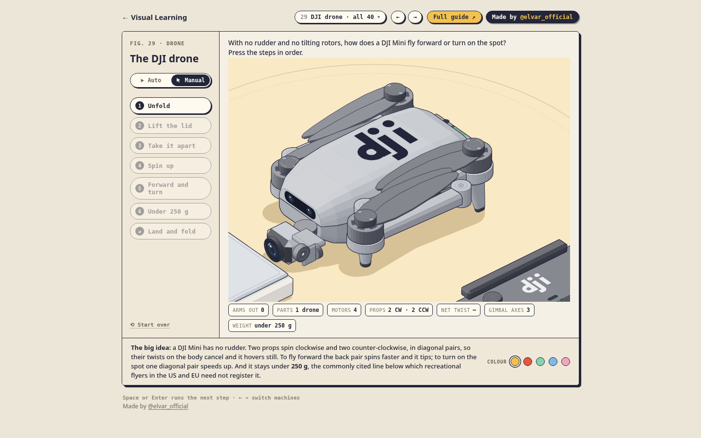
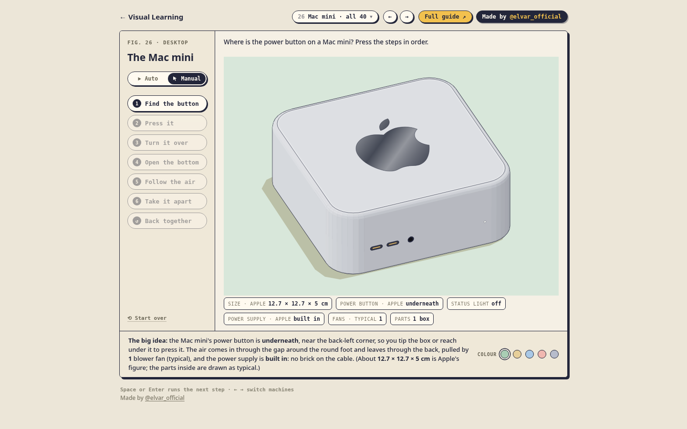
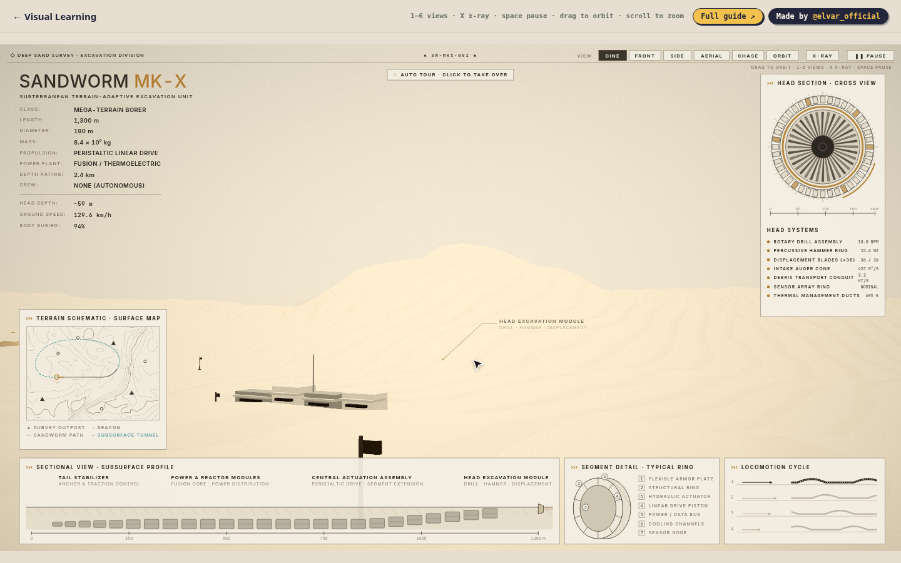
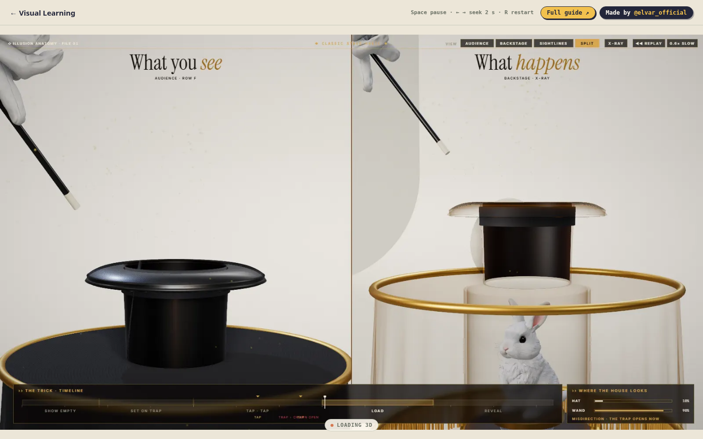
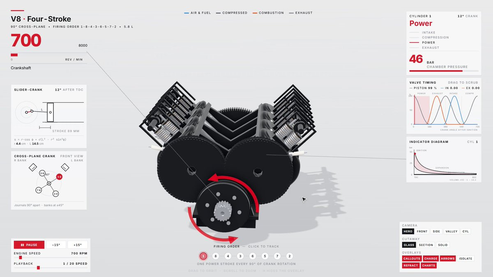
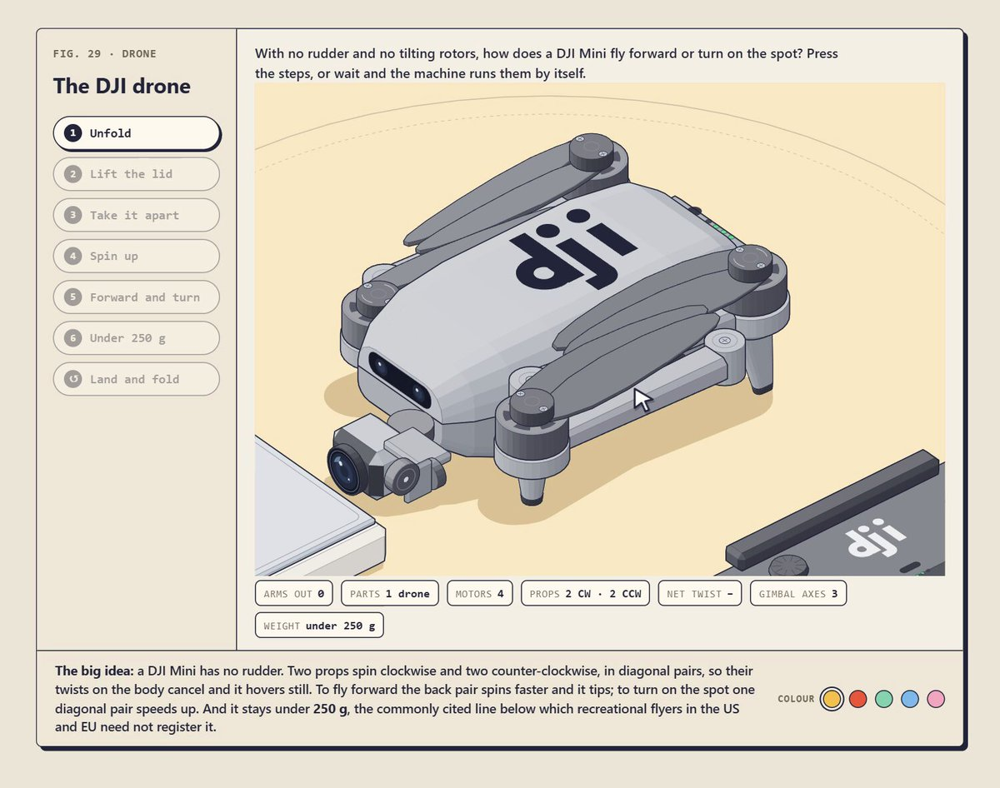

# Elvar 可拆解机器 Anatomy（Claude Code 全流程）

- **类型**：交互网页 / 可点击拆解的机器模拟 · 录屏出片 · 小站部署
- **技术栈**：Claude Code · `anatomy` skill · 单文件 HTML（Three.js 或纯 JS + SVG）· 无头 Chrome · ffmpeg
- **原作者**：[@elvar_official](https://x.com/elvar_official)（Elvar）
- **出处**：长文 [How I Turn Any Question Into a Machine You Can Run](https://x.com/elvar_official/article/2111831136171151589) + 他的成片帖（V8、无人机、Mac mini、机器狗、魔术帽、沙虫等）
- **Skill**：[wheresryan22/anatomy](https://github.com/wheresryan22/anatomy)（免费）
- **在线演示**：[visual-learning.app](https://visual-learning.app)
- **标签**：`claude-code` `anatomy` `交互模拟` `拆解动画` `等轴测` `threejs` `svg` `seek录制` `ffmpeg` `vibe-coding`

> 说明：本页提示词**全部来自 Elvar 的公开长文与帖子**，这里只做收集、中文翻译与流程整理，版权与创意归原作者。英文原文逐字附在每节的折叠区里，复制英文原文效果最稳；方括号 `[...]` 里的内容换成你自己的主题。

---

## 演示截图

| 无人机拆解（DJI drone） | Mac mini |
| --- | --- |
|  |  |
| **沙虫 Sandworm MK-X** | **帽子里的兔子（魔术拆解）** |
|  |  |
| **V8 四冲程（成片帖封面）** | **无人机（成片帖封面）** |
|  |  |

截图来源：[visual-learning.app/dji-drone](https://visual-learning.app/dji-drone)、[/mac-mini](https://visual-learning.app/mac-mini)、[/sandworm](https://visual-learning.app/sandworm)、[/rabbit-from-a-hat?v=2](https://visual-learning.app/rabbit-from-a-hat?v=2)，以及 [V8 帖](https://x.com/elvar_official/status/2115882221319958984)、[无人机帖](https://x.com/elvar_official/status/2113233371178422472) 的视频封面。

---

## 核心思路

不是「一段提示词出一个 3D 模型」，而是：

**Claude Code + anatomy skill → 一个可点击、一步一个按钮的单页 HTML 机器 →（可选）seek 逐帧录成视频 → 挂到小站上**

Elvar 反复强调的三条：

1. **先写数学，再画画面**：先把真实物件写成一个纯函数模型，屏幕上每个数字都由它驱动，数字自洽了再渲第一帧。
2. **一步一个按钮**：左栏步骤按钮，只有下一步可点。
3. **一个大观点**：图下一句 "The big idea: ..."。

---

## 完整制作流程

**0. 环境**

- Claude Code（任意包含它的套餐）
- Node ≥ 22.20
- Chrome（skill 用无头浏览器自检截图）
- 要出视频再装 ffmpeg + Python（可以直接让 Claude 装）

**1. 安装 skill**

```bash
npx skills add wheresryan22/anatomy -g -a claude-code
```

打开 Claude Code，输入 `/anatomy` 开始。

**2. 选题**：要有「会动的零件」+「能核对的真实数字」。长文举例：马桶回水、自行车变速、钥匙开锁、电梯停层、复利；他的成片：手表、手机、无人机、V8、机器狗、Mac mini。

**3. 依次发提示词 1 → 4**：建机器 → 一眼能读 → 画风 → 当批评家自检。

**4. 出视频（提示词 5 → 6 → 7 连发）**：加 `window.seek(t)` → 无头 Chrome 60fps 逐帧截图进 ffmpeg → 代码合成配乐和音效混进去。

**5. 批量（提示词 8）**：多个 agent 并行，每台机器一个文件夹，同一套规则。

**6. 上线（提示词 9）**：首页卡片 + 每台机器一页 + 分享预览图 → 部署 Vercel。

**7. Bonus（提示词 10）**：加一个滑块改参数，模型重算，仪表跟着变。

**他在帖子里补充的干活习惯**

- **机器狗**：分步搭（腿 → 步态 → 上台阶 → 跌倒起身 → 相机视锥 → 拆成 26 件）；Opus 写运动与拆解，纯 JS + SVG 绘制（可以完全不用 3D 引擎），他自己定 tour 顺序和反馈轮次。
- **魔术帽**：主体用 three.js 按数字搭；兔子、手套这类有机物用 **Tripo** 生成模型，其余全是代码。
- **沙虫**：Claude 先写运动函数；按精确时间跳帧渲染（例：1950 帧 / 60fps）；音效也用代码合成。
- **发布节奏**：成片视频 + "How it works" 要点 + 引用长文；有人要互动时在回复里贴 playground 链接。

---

## 提示词 1：建机器（中文）

`/anatomy` 有人问我：「[意式咖啡机是怎么做出咖啡的？]」

用一台机器来回答，而不是一张示意图。搭一台真实、一眼能认出来的 [拉杆式意式咖啡机，旁边一台磨豆机，外加手柄、压粉器、奶缸和放在秤上的杯子]，由很多小零件组成，等轴测视角，做成一个独立的 HTML 页面。

步骤是左侧一列按钮：[研磨 18 g] [压粉] [扣上手柄] [拉下拉杆] [松手] [打奶] [倒奶] [换新杯]。只有下一步可以点。每个按钮都在机器本身上播放这一步。

在真正干活的部位切开一个窗口 [冲煮头：里面的活塞、弹簧和水]，让观众同时看到原因和结果。

在画任何东西之前，先把真实物件写成一个小的纯函数模型。屏幕上每个数字都由它驱动：[进 18 g 咖啡粉，27 秒出 36 g 浓缩；冲煮压力 9 bar，弹簧回弹时降到 6 bar；锅炉 1.1 bar；牛奶 36 秒从 4 °C 升到 62 °C]。把这些数字实时显示在压力表、机器自带的显示屏，以及图下方的小标签上。如果你不确定某个数字是真的，直接说出来，并告诉我它来自哪里。

图下方一行字：「The big idea: [是弹簧产生了压力]。」

<details>
<summary>英文原文（English original）</summary>

```text
/anatomy Someone asked me: "[How does an espresso machine make coffee?]"

Answer with a machine, not a diagram. Build a real, recognisable [lever espresso machine with a burr grinder beside it, a portafilter, a tamper, a milk jug and a cup on a scale], made of many small parts, in isometric view, as one standalone HTML page.

The steps are buttons in a column on the left: [Grind 18 g] [Tamp] [Lock it in] [Pull the lever] [Let go] [Steam the milk] [Pour] [New cup]. Only the next step is clickable. Each button plays that step on the machine itself.

Cut a window into the part where the real work happens [the group head: the piston, the spring and the water inside]. The viewer sees the cause and the result together.

Write one small model of the real thing as a pure function before you draw anything. Drive every number on screen from it: [18 g of coffee in, 36 g of espresso out in 27 s, brew pressure 9 bar falling to 6 as the spring opens, boiler at 1.1 bar, milk from 4 °C to 62 °C in 36 s]. Show them live on gauges, on displays built into the machine and as small chips under the figure. If you are not sure a number is real, say so and tell me where it comes from.

Under the figure, one line: "The big idea: [a spring makes the pressure]."
```

</details>

---

## 提示词 2：一眼能读（中文）

让它一眼就能看懂，但不要把数字简化掉：

- 每一步在顶部给一句简短提示，简单到 7 岁小孩能懂：正在发生什么、为什么。
- 大号胶囊按钮，左边圆圈里写序号；正在运行的步骤高亮，已完成的步骤变淡。
- 每个动作上加一个手写的小拟声词：磨豆机 grrrr，手柄扣上 tok，蒸汽棒 psssh，敲出粉饼 knock。
- 当某一步比真实时间快或慢时显示倍速徽章（×4、×1/20），由真实秒数计算得出。
- 步骤上方一个两档开关：默认 Manual（手动），没人按就什么都不动，下一个按钮会脉动提示；Auto（自动），机器自己循环跑完所有步骤。在多次访问间记住选择。
- 一个「Start over」链接，把机器复位到第 1 步。
- [可选] 图下方 3 张编号步骤卡片、一个小机器人吉祥物，以及一个播放全过程的「Show me」按钮。

<details>
<summary>英文原文（English original）</summary>

```text
Make it readable at a glance without dumbing down the numbers:
- one short hint at the top for each step, simple enough for a 7-year-old: what is happening and why
- big pill buttons with a number in a circle; the running step lights up, finished steps fade
- a small handwritten sound word on each action: grrrr at the grinder, tok when the basket locks, psssh at the steam wand, knock when the puck comes out
- a speed badge whenever a step runs faster or slower than real time (×4, ×1/20), computed from the real seconds
- a switch with 2 modes above the steps: Manual by default, where nothing moves until someone presses a step and the next button pulses; Auto, where the machine runs every step by itself on a loop. Remember the choice between visits
- a "Start over" link that puts the machine back at step 1
- [optional] 3 numbered step cards under the figure, a small robot mascot and a "Show me" button that plays the whole thing
```

</details>

---

## 提示词 3：画风（中文）

风格：手绘墨线的儿童绘本，而不是技术图纸。

- 深海军蓝墨线描边，1.2 px；平涂色块，每种颜色 3 个色阶（顶面最亮，侧面更暗）。
- 奶油色纸张背景（#f5f0e5），每个物件一种醒目的主色，金属部件用铬和黄铜。
- 图下方放色板，点击可给机器换色。
- 短而硬边的暖灰色阴影（#ddd4c3），落在每个物件正后方；绝不用蓝色或紫色阴影。
- 每个表盘、显示屏和标签都放在不被任何东西遮挡的面上。

<details>
<summary>英文原文（English original）</summary>

```text
Style: a hand-inked children's book, not a technical drawing.
- dark navy ink outlines, 1.2 px, flat colour fills with 3 tones per colour (top lightest, sides darker)
- cream paper background (#f5f0e5), one bold colour per object, chrome and brass for the metal parts
- colour swatches under the figure that recolour the machine
- short, hard-edged, warm grey shadows (#ddd4c3) falling just behind each object; never blue or purple
- every dial, display and label sits on a face that nothing else hides
```

</details>

---

## 提示词 4：当批评家自检（中文）

在给我看任何东西之前，先像批评家一样检查：

1. 在每一步的中间截一张静帧并逐张检查：零件被别的零件挡住、文字溢出边框、数字和模型对不上。
2. 对每个超过 1 秒的动作，以 0.1 秒为步长逐帧扫描，统计每帧变化的像素数。某一帧的变化量是相邻帧的 3 倍以上，就是一次跳变：找到并修好。
3. 慢动作必须连续。时长超过一秒的动作，绝不能在预先画好的几个姿势之间跳切。

告诉我你检查了什么、修了什么，并把静帧给我看。

<details>
<summary>英文原文（English original）</summary>

```text
Before you show me anything, check it like a critic:
1. Capture a still in the middle of every step and read each one: a part hidden behind another part, text that overflows its box, a number that disagrees with the model.
2. Scrub every move longer than 1 second at 0.1 s steps and count how many pixels change per frame. A frame that changes 3x more than its neighbours is a jump: find it and fix it.
3. Slow moves must be continuous. Never step through pre-drawn poses on a move that takes longer than a second.
Tell me what you checked and what you fixed. Show me the stills.
```

</details>

---

## 提示词 5：可录制（中文）

让整段导览可以被录制：

- 加一个 `window.seek(t)`，从 0 开始把整段导览重放到时间 t。这样任意一帧都能以任意顺序绘制。
- URL 带 `?render` 时，页面停止自己的时钟。
- 画一个光标，在每一步开始前一点点走到对应按钮并按下去。
- 把整段导览剪到 36 秒：步骤之间 0.7 秒，第一次点击在 0.9 秒；主高潮时刻 [萃取那一下] 保持为最慢的一步。

<details>
<summary>英文原文（English original）</summary>

```text
Make the tour recordable:
- add window.seek(t) that replays the whole tour from zero to time t. Any frame can then be drawn in any order
- with ?render in the URL, the page stops its own clock
- draw a cursor that walks to each button and presses it a moment before the step starts
- cut the whole tour to 36 seconds: 0.7 s between steps, the first click at 0.9 s; the main moment [the shot] stays the slowest step
```

</details>

---

## 提示词 6：录成视频（中文）

录下来：在无头 Chrome 里打开带 `?render` 的页面，以 60 fps、1500×1320 分辨率对每一帧调用 `window.seek()`，逐帧截图并通过管道送进 ffmpeg，编码为 H.264、yuv420p、faststart。然后做一张联系表（contact sheet），每 3 秒取一帧，给我看。

<details>
<summary>英文原文（English original）</summary>

```text
Record it: open the page with ?render in headless Chrome, call window.seek() for every frame at 60 fps at 1500×1320, screenshot each frame and pipe them into ffmpeg as H.264, yuv420p, faststart. Then make a contact sheet with one frame every 3 seconds and show it to me.
```

</details>

---

## 提示词 7：代码配乐（中文）

用代码配乐，不用采样、不需要任何授权：一段 36 秒、84 BPM 的 lo-fi 底乐，柔和电钢琴走 Fmaj7、Em7、Dm7、Cmaj7，圆润的贝斯，第一小节之后进刷子鼓，再加一点微弱的黑胶噪声。在此之上，按画面的精确秒数叠加轻声音效：每次按按钮一声 click、磨豆机的嗡嗡声、蒸汽的嘶嘶声、浓缩流出时细细的水流声。母带到 -14 LUFS，真峰值低于 -1 dB，用 ffmpeg 混进视频。

<details>
<summary>英文原文（English original）</summary>

```text
Score it in code, no samples and nothing to license: a 36-second lo-fi bed at 84 BPM with soft electric piano on Fmaj7, Em7, Dm7, Cmaj7, a round bass, brushed drums after the first bar and faint vinyl crackle. On top, quiet sounds at the exact seconds of the picture: a click on every button press, the grinder's hum, the steam hiss, a thin trickle while the espresso runs. Master to -14 LUFS with the true peak under -1 dB and mux it into the video with ffmpeg.
```

</details>

---

## 提示词 8：并行批量造机器（中文）

并行搭这些机器，每台机器一个 agent：[自动售货机、洗衣机、烤面包机、微波炉、削笔刀、烟雾报警器、冰箱、扭蛋机、自拍亭]。

每个 agent 都遵守我那台咖啡机的规则：同样的外观、步骤按钮、通往机构内部的窗口、一个驱动所有数字的模型、一个大观点。

给每台机器一个要证明的事实，并附上背后的真实数字：[微波炉用一块巧克力测出光速，融化点之间相距 6.12 cm]。

每个 agent 在自己的文件夹里工作，绝不修改共享文件，汇报前先检查自己的静帧。

<details>
<summary>英文原文（English original）</summary>

```text
Build these machines in parallel, one agent per machine: [vending machine, washing machine, toaster, microwave, pencil sharpener, smoke alarm, fridge, capsule toy machine, photo booth].
Every agent follows the rules of my espresso machine: the same look, the step buttons, the window into the mechanism, one model that drives every number, one big idea.
Give each one its own fact to prove, with the real number behind it: [the microwave measures the speed of light off a chocolate bar, 6.12 cm between the melted spots].
Each agent works in its own folder, never edits the shared files and checks its own stills before it reports back.
```

</details>

---

## 提示词 9：做成小站并部署（中文）

把我的这些机器放到一个小站上：

- 首页每台机器一张卡片：最精彩时刻的一张静帧、名字，以及一句话说明它回答了什么问题。
- 每台机器单独一页，顶部有导航：一个带所有机器缩略图的菜单，← → 键切换机器。
- 空格或回车执行下一步。
- 每一页一张 1200×630 的分享预览卡，取自某一步中间的静帧，使用绝对图片 URL，这样链接分享到 X 上时卡片能正常显示。
- 指向其他网站的链接在新标签页打开，让机器停留在观众离开时的状态。
- 部署到 Vercel，并把我的域名指向它。

<details>
<summary>英文原文（English original）</summary>

```text
Put my figures on one small site:
- a front page with one card per figure: a still from its best moment, the name and one line about what it answers
- each figure on its own page with a nav on top: a menu with a thumbnail of every machine, and the ← → keys switch machines
- Space or Enter runs the next step
- a 1200×630 preview card for every page, made from a still in the middle of a step, with absolute image URLs so the card shows up when the link is shared on X
- links to other sites open in a new tab, so the machine stays where the viewer left it
- deploy it to Vercel and point my domain at it
```

</details>

---

## 提示词 10（Bonus）：加一个参数滑块（中文）

加一个滑块控制 [粉量，9 g 到 22 g]，滑动时重新运行模型：[粉量少就流得快而稀，粉量多就会堵住]。结果显示在同样的压力表和数字上。

<details>
<summary>英文原文（English original）</summary>

```text
Add one slider for [the dose, 9 g to 22 g] and run the model again when it moves: [a light dose runs fast and thin, a heavy one chokes]. Show the result in the same gauges and numbers.
```

</details>

---

## 示例：V8 发动机（按提示词 1 填好的版本）

Elvar 的 [V8 帖](https://x.com/elvar_official/status/2115882221319958984) 没有单独贴 V8 专用提示词（写的是 "Every prompt for builds like this is in the article"），但帖里公开了这些参数：cross-plane 曲轴、轴颈相隔 90°、点火顺序 1-8-4-3-6-5-7-2、缸径 101.6 mm / 行程 89 mm / 8 缸 ≈ 5.8 L、活塞与转速表/气门图/压力曲线共用同一套 slider-crank 数学、700 rpm 以 1/20 慢放（曲轴每秒转 210°）、可以停在燃烧中途。下面是**按这些参数套进提示词 1 的整理版**（不是 Elvar 原文）：

**中文**

`/anatomy` 有人问我：「cross-plane V8 是怎么点火、怎么运转的？」

用一台机器来回答，而不是一张示意图。搭一台真实、一眼能认出来的 cross-plane V8 发动机 [缸径 101.6 mm、行程 89 mm、8 缸约 5.8 L]，由很多小零件组成，等轴测视角，做成一个独立的 HTML 页面。

步骤是左侧一列按钮：[怠速] [转一整圈] [剖开] [1/20 慢放] [停在燃烧中途] [显示气门] [显示压力] [重来]。只有下一步可以点。

在真正干活的部位切开一个窗口 [一个气缸：活塞、连杆、曲轴轴颈、进排气门]。

在画任何东西之前，先写一个纯函数模型。所有数字都由曲轴转角驱动：[点火顺序 1-8-4-3-6-5-7-2，轴颈相隔 90°，700 rpm 以 1/20 显示，即曲轴每秒转 210°]。把它们实时显示在转速表、气门正时图和压力曲线上。

图下方一行字：「The big idea: [一个曲轴转角驱动所有读数]。」

<details>
<summary>英文版（English, adapted from prompt 1）</summary>

```text
/anatomy Someone asked me: "How does a cross-plane V8 fire and move?"

Answer with a machine, not a diagram. Build a real, recognisable cross-plane V8 engine [bore 101.6 mm, stroke 89 mm, 8 cylinders, about 5.8 L], made of many small parts, in isometric view, as one standalone HTML page.

The steps are buttons in a column on the left: [Idle] [One revolution] [Cutaway] [Slow 1/20] [Pause mid-fire] [Show valves] [Show pressure] [Restart]. Only the next step is clickable. Each button plays that step on the engine itself.

Cut a window into the part where the real work happens [one cylinder: piston, rod, crank journal, intake and exhaust valves]. The viewer sees the cause and the result together.

Write one small model of the real thing as a pure function before you draw anything. Drive every number on screen from crank angle: [firing order 1-8-4-3-6-5-7-2, crank journals 90° apart, one slider-crank model for every piston, 700 rpm shown at 1/20 so the crank turns 210° per second]. Show them live on the rev counter, the valve timing chart and the pressure curve. If you are not sure a number is real, say so and tell me where it comes from.

Under the figure, one line: "The big idea: [one crank angle drives every readout]."
```

</details>

之后照常接提示词 2–7（可读性、画风、自检、seek 录制、出片、配乐）。

---

## 致谢

- 提示词与方法：[@elvar_official](https://x.com/elvar_official) · [原文长文](https://x.com/elvar_official/article/2111831136171151589)
- Skill：[wheresryan22/anatomy](https://github.com/wheresryan22/anatomy)
- 演示：[visual-learning.app](https://visual-learning.app)

本仓库仅做收集与翻译，非原创。
