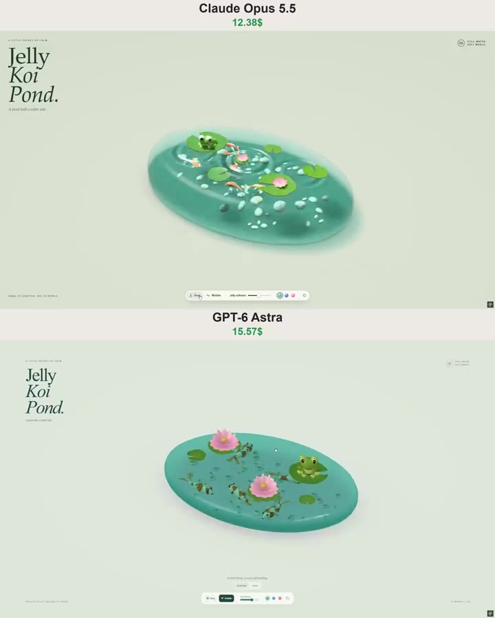

# 果冻锦鲤池 Jelly Koi Pond

- **类型**：交互网页 / 果冻软体场景
- **技术栈**：3D（未指定库）· 程序化几何 · 单文件 HTML
- **标签**：`软体模拟` `果冻` `锦鲤` `程序化建模` `创意编程` `vibe-coding` `ai-测试`
- **测试模型**：Claude Opus 5.5 vs ChatGPT-6 Astra
- **来源**：[@vib3coded](https://x.com/vib3coded) · [原帖](https://x.com/vib3coded/status/2108256366879981677) · [提示词帖](https://x.com/vib3coded/status/2108256735886487863) · 2026-10-09（北京时间）

> 说明：这是 [@vib3coded](https://x.com/vib3coded) 用来横向测试 AI 模型的提示词（同一提示词交给 Claude Opus 5.5 vs ChatGPT-6 Astra）。界面上的按钮、标题、提示语等文字按原提示词要求保持英文（引号里的英文原样保留）。英文原文附在文末。

---

## 效果



## 提示词（中文）

在一个自包含 HTML 文件中构建一个交互式 3D "Jelly Koi Pond"（果冻锦鲤池）。

创建一个完全由柔软、半透明果冻构成的小椭圆形池塘，漂浮在暖色粉彩背景上方一点点。在果冻内部加入色彩斑斓的锦鲤和光滑的小卵石。在表面放置荷叶、粉色睡莲，以及一只大眼睛的可爱绿色青蛙。

这个池塘应该看起来像一座被困在光亮软糖里的精美日式微缩庭园。给它可见的厚度、圆润的边缘、柔和的反射、可信的透明度，以及下方柔和的阴影。

### 让果冻可以物理交互

- 点击并拖动池塘的任意部位来拉伸和抬起它。
- 池塘应局部变形，而不是作为一个刚体整体移动。
- 松开后，让它弹跳、晃动，然后逐渐平静。
- 鱼、卵石、荷叶、花和青蛙都要附着在变形池塘内部或表面的相应位置上。
- 池塘未受扰动时，让锦鲤缓慢游动。
- 点击表面应产生小涟漪。

添加一个紧凑、优雅的控制条：Drag（拖动）和 Wobble（晃动）模式、果冻柔软度滑块、三种颜色选项（薄荷绿、蓝、粉）以及重置按钮。

使用极简编辑式布局：左上角是大号衬线标题 "Jelly Koi Pond."，小字交互提示，充足的留白，柔和的鼠尾草绿背景。让池塘保持为视觉焦点。

使用程序化的几何体和材质，不用外部图片或模型资源。包含光照、阴影、鼠标和触摸支持以及响应式缩放。在用力拖动和反复交互时保持模拟稳定。

交付一个完整可用的体验，而不是静态样稿。

---

<details>
<summary>英文原文（English original）</summary>

```text
Build an interactive 3D “Jelly Koi Pond” in a single self-contained HTML file.

Create a small oval pond made entirely of soft, translucent jelly, floating just above a warm pastel background. Inside the jelly, add colorful koi fish and smooth little pebbles. Place lily pads, pink water lilies, and one adorable green frog with big eyes on the surface.

The pond should look like a beautiful miniature Japanese garden trapped inside a glossy gummy candy. Give it visible thickness, rounded edges, soft reflections, convincing transparency, and a soft shadow underneath.

Make the jelly physically interactive:
- Click and drag any part of the pond to stretch and lift it.
- Deform the pond locally rather than moving it as a rigid object.
- On release, let it bounce and wobble before gradually settling.
- Keep the fish, pebbles, lily pads, flowers, and frog attached to their positions within or on the deforming pond.
- Let the koi swim slowly when the pond is undisturbed.
- Clicking the surface should create a small ripple.

Add a compact, elegant control bar with Drag and Wobble modes, a jelly softness slider, three color options (mint, blue, and pink), and a reset button.

Use a minimal editorial layout with a large serif “Jelly Koi Pond.” title in the upper-left corner, small interaction hints, generous whitespace, and a soft sage background. Keep the pond as the main focus.

Use procedural geometry and materials, with no external image or model assets. Include lighting, shadows, mouse and touch support, and responsive resizing. Keep the simulation stable during strong dragging and repeated interactions.

Deliver a complete working experience, not a static mockup.
```

</details>
