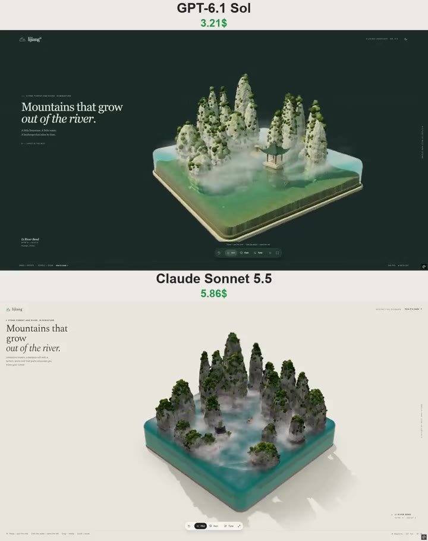

# 雾中喀斯特 Karst in the Mist

- **类型**：交互网页 / 3D 水体微缩场景
- **技术栈**：Three.js r160 · WebGL · SSR · 体积雾层
- **标签**：`threejs` `webgl` `水面模拟` `喀斯特` `漓江` `雾` `微缩场景` `vibe-coding` `ai-测试`
- **测试模型**：Claude Sonnet 5.5 vs GPT-6.1 Sol
- **来源**：[@vib3coded](https://x.com/vib3coded) · [原帖](https://x.com/vib3coded/status/2111242759860351300) · [提示词帖](https://x.com/vib3coded/status/2111242878546813096) · 2026-10-17（北京时间）

> 说明：这是 [@vib3coded](https://x.com/vib3coded) 用来横向测试 AI 模型的提示词（同一提示词交给 Claude Sonnet 5.5 vs GPT-6.1 Sol）。界面上的按钮、标题、提示语等文字按原提示词要求保持英文（引号里的英文原样保留）。优先使用英文原文；中文翻译附在后面。

---

## 效果



## 提示词（英文原文）

```text
Build a single-file interactive WebGL diorama (one index.html, no build step) with Three.js r160 loaded via an import map from cdn.jsdelivr.net, plus OrbitControls and BufferGeometryUtils (mergeVertices, mergeGeometries) from three/examples/jsm. Everything is procedural — no external models or textures. English UI.

CONCEPT
"Karst in the Mist": a miniature of the Li River karst near Guilin inside a 10×10 block of clear jade-green water with rounded edges (vertical corner radius ~0.6, top edge radius ~0.26), on a thin sand-colored base slab, on a rice-paper background with a soft floor shadow that fades out with distance.

TERRAIN
- Heightfield river bed (~340×340, clipped to the rounded block, with a boundary skirt so the cross-section shows through the water): deep silty bed around -0.9, a winding central channel (center u = 0.2 − 0.35·sin(0.9·v) in a camera-facing local frame), small grassy banks around some tower feet, and one low islet for a pavilion. Darker river-silt colors (not bright sand), wet band at the waterline, procedural caustics only on the bed.

KARST TOWERS (the hero)
- ~20 towers placed by rejection sampling: radius 0.36–0.96, keep the channel and the pavilion islet clear, allow slight overlaps for twin peaks, heights growing toward the back (≈1.0 in front to ≈4.0 at the back), plus one tall hero tower at the back.
- Each tower is a deformed cylinder (≈64 rings × 72 segments) from below the river bed to its apex: conical sugarloaf profile r = R·(1 − s^1.85)^0.5·(1 + 0.1·s(1−s)) with s = y/H, slightly wider below water, an undercut erosion notch at the waterline, horizontal bedding ledges (small sine on the radius), vertical flutes from 2D noise sampled on (cosθ, sinθ) with slow variation in y, and a gentle lean toward the top.
- IMPORTANT: wind the triangles so the faces point OUTWARD (for ring j, segment i: a=(j,i), b=(j,i+1), c=(j+1,i), d=(j+1,i+1) → triangles a,c,b and b,c,d), then computeVertexNormals. Inward winding makes the towers look hollow/transparent and breaks every normal-based rule below.
- Stone shader (world space): light limestone with noise variation, darker vertical drip stains, rusty orange streaks, subtle bedding bands, moss on upward-facing surfaces (smoothstep on normal.y plus noise) starting a little above the water, darker wet band at the waterline, algae below it; procedural bump from dFdx/dFdy.
- Vegetation from the tower vertices with outward normals: sparse larger canopy blobs on upward-facing ledges and the summits (InstancedMesh of displaced icospheres, detail 2, per-instance AO), and many small shrub blobs on the slopes (separate InstancedMesh, detail 1); leave bare cliff patches via noise. Olive-to-fresh-green palette.
- Bamboo clumps on the banks and the islet (thin leaning culms + small light-green leaf blobs), boulders at the tower feet.
- A small Chinese pavilion on the islet: stone plinth, four red columns with beams, a square roof with strongly upturned corners (hip-roof generator with concave profile and lifted eaves), gold finial, a lantern inside.

RAFT
- A bamboo raft (7 poles with lashings), a fisherman in a conical straw hat holding a long pole, two black cormorants, and a lantern on a pole at the bow (emissive + point light at twilight).
- It follows a loop of waypoints along the channel, steers around towers (repulsion) and away from shallow water, bobs and tilts with a JS copy of the shader's ambient wave function, and injects a wake into the ripple simulation every frame. Clicking the water sends it to that point.

WATER (realistic, not jelly)
- Pipeline: opaque scene → MSAA HalfFloat target with DepthTexture; copy to a second target; draw the water with a custom ShaderMaterial doing a manual depth test; then mist layers and rain; final fullscreen pass with ACES tone mapping, sRGB and a subtle tilt-shift. Transparent canvas over the CSS background.
- Color from real thickness (Beer–Lambert toward a deep jade scatter color derived from the user's water color), screen-space refraction, Fresnel sky reflection, and screen-space reflections (~28 ray-march steps) so the towers mirror in the calm river. Keep sun glints and detail normals subtle — a calm river, not glitter.
- Ripples: GPU wave equation on a 256×256 HalfFloat ping-pong target with a land mask that includes the tower footprints, two drop slots (cursor path + raft wake), and rain: a per-texel hashed random impulse each step whose probability follows the rain amount. Shore foam only on gentle slopes near the water level.

MIST (signature mechanic)
- 4–6 horizontal noise layers between y≈0.05 and 1.55 over the block (denser low, thinner high, faded at the block edges), drifting slowly, rendered after the water with alpha blending, a manual depth test against the scene depth and a soft fade near geometry so the towers rise through it.
- A 128×128 HalfFloat "clearing mask" ping-pong texture: the cursor path carves a soft channel, the raft keeps a small clearing around itself, a click punches a hole, and the mask refills over a few seconds. The layers multiply their alpha by the mask.
- Mist colors follow the time of day (pink-gold at dawn, neutral at noon, apricot-mauve at dusk, grey in rain).

RAIN & TIME OF DAY
- Rain toggle: animated amount 0 ↔ 0.75 that drives the sim impulses, ~500 thin camera-facing streak quads that respawn when they hit water or ground, a greyer and dimmer light, and reduced ripple foam.
- Time of day slider shown as a clock 05:30–19:30: sun elevation follows sin(π·t), azimuth swings ±55°, warm twilight colors at both ends, sky reflection and hemisphere colors shift, lanterns glow at twilight.

UI (editorial, minimal)
Brand "lijiang°" with a small three-peak mark, headline "Mountains that grow / out of the river.", eyebrow "Stone forest and river, in miniature", vertical caption "A study of mist and stone", location "Li River Bend · 24°55′ N · 110°31′ E", a floating pill dock (reset, Mist toggle, Rain toggle, Tune, fullscreen), hints ("Move — part the mist", "Click the water — send the raft", "Drag — rotate", "Scroll — zoom"), adaptive FPS + clock in the footer, a glassy settings panel (mist, rain, time of day; water color, wave height, ripple strength, clarity, caustics; sun azimuth, tilt-shift) and a "How it's made" card. Jade accent, light and dark themes via CSS tokens, responsive to 390 px, prefers-reduced-motion respected, adaptive pixel ratio and a lighter mode for touch devices. Intro: the water fills the block while the camera eases in.
```

---

## 提示词（中文）

构建一个单文件交互式 WebGL 微缩场景（一个 index.html，无构建步骤），通过 import map 从 cdn.jsdelivr.net 加载 Three.js r160，并从 three/examples/jsm 引入 OrbitControls 和 BufferGeometryUtils（mergeVertices、mergeGeometries）。一切都是程序化的——不使用外部模型或纹理。界面为英文。

### 概念

"Karst in the Mist"（雾中喀斯特）：桂林附近漓江喀斯特地貌的微缩模型，置于一个 10×10、边缘为圆角的清澈翡翠绿水块中（竖直转角半径约 0.6，顶边半径约 0.26），放在一块薄薄的沙色底板上，背景是宣纸质感，地面有一道随距离淡出的柔和阴影。

### 地形

- 高度场河床（约 340×340，裁切到圆角水块内，沿边界有一圈裙边，使横截面透过水体可见）：约 -0.9 深的淤泥河床，一条蜿蜒的中央河道（在面向相机的局部坐标系中，中心 u = 0.2 − 0.35·sin(0.9·v)），部分峰丛脚下有小块长草的河岸，还有一座供亭子用的低矮小洲。使用更深的河泥色（不是明亮的沙子），水线处有湿带，程序化焦散只出现在河床上。

### 喀斯特峰林（主角）

- 用拒绝采样放置约 20 座山峰：半径 0.36–0.96，避开河道和亭子所在的小洲，允许轻微重叠形成双峰，越往后越高（前面约 1.0，后面约 4.0），另加后方一座高大的主峰。
- 每座山峰是一个变形圆柱（约 64 环 × 72 段），从河床以下一直到峰顶：圆锥形"糖面包"轮廓 r = R·(1 − s^1.85)^0.5·(1 + 0.1·s(1−s))，其中 s = y/H；水下部分略宽，水线处有一道侵蚀凹槽（undercut notch），水平的层理台阶（在半径上加小幅正弦），在 (cosθ, sinθ) 上采样二维噪声并随 y 缓慢变化形成竖直沟槽，以及朝顶部的轻微倾斜。
- **重要**：三角形的绕序要让面朝**外**（对第 j 环、第 i 段：a=(j,i)，b=(j,i+1)，c=(j+1,i)，d=(j+1,i+1) → 三角形 a,c,b 和 b,c,d），然后 computeVertexNormals。向内的绕序会让山峰看起来是空心/透明的，并破坏下面所有基于法线的规则。
- 石头着色器（世界空间）：带噪声变化的浅色石灰岩，较深的竖直滴痕，锈橙色条纹，细微的层理条带，朝上表面上的苔藓（对 normal.y 做 smoothstep 再加噪声），从水面上方一点开始，水线处较深的湿带，水下有藻类；通过 dFdx/dFdy 做程序化凹凸。
- 从山峰上法线朝外的顶点生成植被：在朝上的台阶和峰顶上放稀疏、较大的树冠团块（置换 icosphere 的 InstancedMesh，细分 2，逐实例 AO），在坡面上放大量小灌木团块（单独的 InstancedMesh，细分 1）；用噪声留出裸露的崖壁。橄榄绿到鲜绿的调色板。
- 河岸和小洲上的竹丛（细长倾斜的竹竿 + 浅绿色小叶团），山脚下的巨石。
- 小洲上的一座小中式亭子：石基座，四根红柱和横梁，四角高高翘起的方形屋顶（带内凹轮廓和上翘檐口的四坡屋顶生成器），金色宝顶，亭内一盏灯笼。

### 竹筏

- 一张竹筏（7 根竹竿加绑绳），一位戴斗笠、手持长篙的渔夫，两只黑色鸬鹚，船头竿上挂一盏灯笼（黄昏时自发光 + 点光源）。
- 它沿河道上的一圈路径点航行，绕开山峰（斥力）并远离浅水，用着色器环境波函数的 JS 副本来起伏和倾斜，并每帧向涟漪模拟注入尾迹。点击水面会把它派到那个点。

### 水（写实，不是果冻）

- 管线：不透明场景 → 带 DepthTexture 的 MSAA HalfFloat 目标；复制到第二个目标；用自定义 ShaderMaterial 绘制水面并做手动深度测试；然后是雾层和雨；最后一个全屏通道做 ACES 色调映射、sRGB 和轻微移轴。透明 canvas 叠在 CSS 背景上。
- 颜色来自真实厚度（按 Beer–Lambert 趋向由用户水色派生出的深翡翠散射色），屏幕空间折射，菲涅尔天空反射，以及屏幕空间反射（约 28 步光线步进），让山峰倒映在平静的江面上。阳光闪烁和细节法线要保持克制——是一条平静的河，不是一片闪光。
- 涟漪：在 256×256 HalfFloat ping-pong 目标上做 GPU 波动方程，陆地遮罩包含山峰的占地范围，两个水滴注入槽（光标路径 + 竹筏尾迹），以及雨：每步对每个纹素做哈希随机冲量，其概率跟随雨量。岸边泡沫只出现在靠近水面的平缓斜坡上。

### 雾（标志性机制）

- 在水块上方 y≈0.05 到 1.55 之间放 4–6 层水平噪声层（低处更浓，高处更薄，在块边缘淡出），缓慢飘动，在水面之后用 alpha 混合渲染，对场景深度做手动深度测试，并在几何体附近柔和淡出，让山峰从雾中升起。
- 一张 128×128 HalfFloat 的"驱散遮罩"ping-pong 纹理：光标路径划开一条柔和的通道，竹筏在周围保持一小片空地，点击会打出一个洞，遮罩在几秒内重新填满。各雾层把自己的 alpha 乘以该遮罩。
- 雾的颜色跟随时间变化（黎明粉金色，正午中性，黄昏杏色偏紫，雨天灰色）。

### 雨与时间

- 下雨开关：雨量在 0 ↔ 0.75 之间做动画，驱动模拟冲量；约 500 个细长的、面向相机的雨丝四边形，落到水面或地面后重新生成；光线变灰变暗；涟漪泡沫减少。
- 时间滑块以 05:30–19:30 的时钟显示：太阳高度跟随 sin(π·t)，方位角摆动 ±55°，两端为温暖的晨昏色彩，天空反射和半球光颜色随之变化，晨昏时灯笼发光。

### UI（编辑风格、极简）

品牌标识 "lijiang°" 配一个三峰小标志，标题 "Mountains that grow / out of the river."，眉标 "Stone forest and river, in miniature"，竖排说明文字 "A study of mist and stone"，地点 "Li River Bend · 24°55′ N · 110°31′ E"，一个悬浮胶囊工具栏（reset、Mist 开关、Rain 开关、Tune、全屏），提示（"Move — part the mist"、"Click the water — send the raft"、"Drag — rotate"、"Scroll — zoom"），页脚放自适应 FPS + 时钟，一个玻璃质感的设置面板（雾、雨、时间；水色、波高、涟漪强度、清澈度、焦散；太阳方位角、移轴），以及一张 "How it's made" 卡片。翡翠色强调色，通过 CSS token 实现亮色和暗色主题，响应式适配到 390 px，遵守 prefers-reduced-motion，自适应像素比，并为触屏设备提供更轻量的模式。开场：水注满水块，同时相机缓缓推近。
