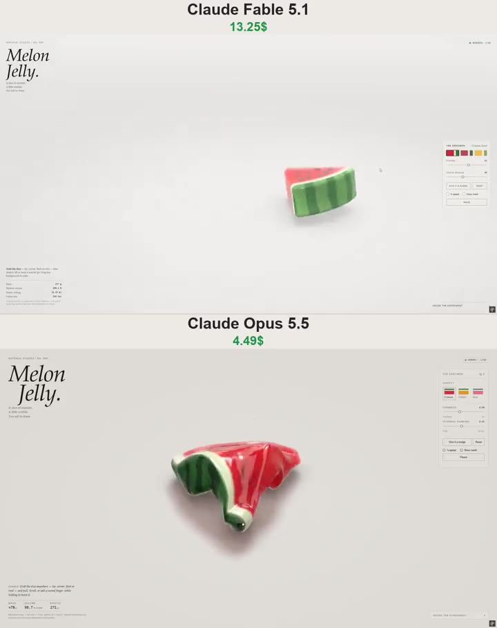

# 西瓜果冻 Melon Jelly

- **类型**：交互网页 / 软体果冻
- **技术栈**：WebGPU · WGSL · XPBD 四面体软体 · 单文件 HTML
- **标签**：`webgpu` `wgsl` `xpbd` `软体模拟` `果冻` `material-studies` `vibe-coding` `ai-测试`
- **测试模型**：Claude Fable 5.1 vs Claude Opus 5.5
- **来源**：[@vib3coded](https://x.com/vib3coded) · [原帖](https://x.com/vib3coded/status/2109205399513489436) · [提示词帖](https://x.com/vib3coded/status/2109205938158637113) · 2026-10-11（北京时间）

> 说明：这是 [@vib3coded](https://x.com/vib3coded) 用来横向测试 AI 模型的提示词（同一提示词交给 Claude Fable 5.1 vs Claude Opus 5.5）。英文原文在 X 上发布时是一整段（分节标题和换行都挤在一起），下方英文原文按原样保留；中文翻译按原文的分节标题重新分段，便于阅读。界面上的按钮、标题、提示语等文字按原提示词要求保持英文（引号里的英文原样保留）。英文原文附在文末。

---

## 效果



## 提示词（中文）

创建 "Melon Jelly"（西瓜果冻）——一块精致的交互式 3D 西瓜果冻切片，使用真正的 WebGPU 和 WGSL 着色器直接在浏览器中运行。交付一个单文件自包含 HTML，内嵌 JavaScript 和 CSS。这必须是真正的交互式 3D 模拟，而不是静态渲染、视频或 2D 仿制。

### 西瓜

创建一块厚实、圆润的三角形西瓜楔块，包括：

- 半透明的宝石红果冻果肉。
- 果肉与瓜皮之间一层浅色、略微半透明的夹层。
- 有光泽的绿色外皮，带不规则的深绿色条纹。
- 嵌在两个外露切面上的、逐个建模的深色瓜子。
- 柔和的圆角和讨喜、厚实的厚度。

让它看起来像在摄影棚里拍摄的昂贵软糖。它应该显得多汁、柔软，几乎可以吃。颜色要浓郁，但高光不要过曝。

### 软体物理

使用体积软体模拟，例如带 XPBD 弹性约束和体积保持约束的四面体网格。用户必须能够：

- 抓住尖端、某个角、果肉或瓜皮。
- 拉伸、弯曲、抬起并轻轻扭转切片。
- 松手后看它晃动，再逐渐平静下来。

切片必须明显地局部变形，而不是作为一个刚体整体移动或缩放。让瓜皮比果肉稍硬，同时保持整块切片柔韧。拉伸时合理地保持体积。防止单元翻转、爆炸式运动和永久塌陷。使用固定的模拟时间步长和有上限的子步数来保证稳定。松手后，运动应自然衰减——不要瞬间弹回，也不要无休止地振荡。

让瓜子附着在变形的果肉上。它们必须随表面一起移动和旋转，而不是独立漂浮或固定在空间中。

包含地面接触、轻微摩擦和柔和的弹跳。避免明显地穿透地面。

### 渲染

使用原生 WebGPU 和 WGSL 着色器。包括：

- 与厚度相关的光吸收。
- 透过果冻的折射。
- 菲涅尔反射和光泽高光。
- 透过薄边缘的柔和透射光。
- 细微的内部细节和少量小气泡。
- 切片下方柔和的接触阴影。
- 浅色、中性的摄影棚背景。

果肉、浅色瓜皮层和绿色外皮应有各自不同的材质响应。避免让所有东西看起来都像透明玻璃或不透明塑料。

让切片足够大、便于观察，使用四分之三视角的相机，露出果肉、瓜子和厚度。

### 界面

使用极简的编辑式布局：充足的留白、细边框、克制的控件，不要装饰性的 UI 渐变。

左上：
- "MATERIAL STUDIES / NO. 009"
- 一个分成两行的大号斜体衬线标题："Melon" 和 "Jelly."
- 小字说明："A slice of summer." "A little wobble." "Too soft to share."

右上：
- 一个小状态指示器，在渲染器运行时显示 "WEBGPU · LIVE"。

右侧面板："THE SPECIMEN"
- 三套协调的西瓜风格配色预设。
- Firmness（硬度）滑块，并显示当前值。
- Internal damping（内部阻尼）滑块，并显示当前值。
- "Give it a nudge"（推它一下）和 "Reset" 按钮。
- "¼ speed" 和 "Show mesh" 复选框。
- Pause / Resume 按钮。

左下：
- 一句简短提示，说明切片可以被抓住和拉伸。
- 来自模拟的实时质量、相对体积和动能读数。在合适的地方清楚注明示意单位或近似值。

右下：
- 一个可折叠的 "Inside the experiment" 区域，简要解释物理和渲染。

### 行为与性能

支持鼠标和触摸输入。使用指针捕获（pointer capture），确保指针离开物体时拖动依然可靠。让布局在桌面和移动端都可用，控件不遮挡切片。复用缓冲区，避免在拖动时重建几何体或编译着色器。保持交互流畅、响应迅速。遵守减少动态效果（reduced-motion）偏好。如果 WebGPU 不可用，显示清晰的说明，而不是悄悄换成一个假的渲染器。

### 验证

测试从多个位置拖动、用力拉伸、反复松手、与地面碰撞、所有滑块、预设、暂停、重置和慢动作。检查模型能回到稳定的静止形状，瓜子保持附着，网格保持完整，且没有渲染错误。

优先保证果冻响应和光照的质量。结果应该是让人想不停抓起来玩的东西。

---

<details>
<summary>英文原文（English original）</summary>

```text
Create “Melon Jelly” - a polished, interactive 3D watermelon jelly slice that runs directly in the browser using genuine WebGPU and WGSL shaders. Deliver a single, self-contained HTML file with embedded JavaScript and CSS. This must be an actual interactive 3D simulation, not a static render, video, or 2D imitation. THE WATERMELON Create a thick, rounded triangular watermelon wedge with: Translucent ruby-red jelly flesh. A pale, slightly translucent layer between the flesh and rind. A glossy green outer rind with irregular dark-green stripes.  Individually modeled dark seeds embedded in both exposed sides. Softly rounded corners and an appealing, substantial thickness. Make it look like an expensive gummy candy photographed in a studio. It should feel juicy, soft, and almost edible. Keep the colors rich without overexposing the highlights. SOFT-BODY PHYSICS Use a volumetric soft-body simulation, such as a tetrahedral mesh with XPBD elastic and volume-preservation constraints. The user must be able to: Grab the tip, a corner, the flesh, or the rind. Stretch, bend, lift, and gently twist the slice.  Release it and watch it wobble before gradually settling. The slice must visibly deform locally, not simply move or scale as one rigid object. Make the rind slightly firmer than the flesh while keeping the whole slice flexible. Preserve volume reasonably during stretching. Prevent inverted elements, explosive motion, and permanent collapse. Use a fixed simulation timestep and bounded substeps for stability. After release, the motion should decay naturally - no instant snapping back and no endless oscillation. Keep seeds attached to the deforming flesh. They must move and rotate with the surface rather than float independently or remain fixed in space. Include ground contact, gentle friction, and soft bouncing. Avoid visible floor penetration. RENDERING Use native WebGPU with WGSL shaders. Include: Thickness-dependent light absorption. Refraction through the jelly.  Fresnel reflections and glossy highlights. Soft transmitted light through thin edges. Subtle internal details and a few tiny air bubbles.  Soft contact shadows beneath the slice. A light, neutral studio background. The flesh, pale rind, and green skin should have distinct material responses. Avoid making everything look like clear glass or opaque plastic. Keep the slice large and easy to inspect, with a three-quarter camera angle that reveals the flesh, seeds, and thickness. INTERFACE Use a minimal editorial layout with generous whitespace, thin borders, restrained controls, and no decorative UI gradients. Top left: “MATERIAL STUDIES / NO. 009” A large italic serif heading split across two lines: “Melon” and “Jelly.” Small caption: “A slice of summer.” “A little wobble.” “Too soft to share.” Top right: A small status indicator showing “WEBGPU · LIVE” when the renderer is running.  Right-side panel: “THE SPECIMEN” Three coordinated watermelon-inspired color presets. Firmness slider with its current value. Internal damping slider with its current value. “Give it a nudge” and “Reset” buttons. “¼ speed” and “Show mesh” checkboxes.  Pause / Resume button. Bottom left: A short hint explaining that the slice can be grabbed and stretched. Live mass, relative volume, and kinetic-energy readouts derived from the simulation. Clearly describe illustrative units or approximate values where appropriate. Bottom right:  A collapsible “Inside the experiment” section briefly explaining the physics and rendering. BEHAVIOR AND PERFORMANCE Support both mouse and touch input. Use pointer capture so dragging remains reliable when the pointer leaves the object. Make the layout work on desktop and mobile without controls covering the slice. Reuse buffers and avoid rebuilding geometry or compiling shaders during dragging. Keep interaction smooth and responsive. Respect reduced-motion preferences. If WebGPU is unavailable, display a clear explanation instead of silently substituting a fake renderer. VALIDATION Test dragging from several locations, strong stretches, repeated releases, ground collisions, all sliders, presets, pause, reset, and slow motion. Check that the model returns to a stable resting shape, seeds stay attached, the mesh remains intact, and there are no rendering errors. Prioritize the quality of the jelly response and lighting. The result should be something people want to keep grabbing and playing with.
```

</details>
