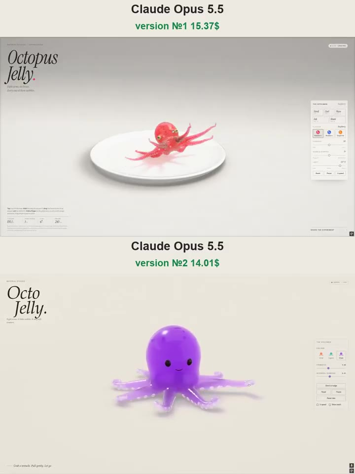

# 章鱼果冻 Octopus Jelly

- **类型**：交互网页 / 果冻生物
- **技术栈**：WebGPU · XPBD 软体 · 粒子链腕足
- **标签**：`webgpu` `xpbd` `软体模拟` `果冻` `章鱼` `material-studies` `vibe-coding` `ai-测试`
- **测试模型**：Claude Opus 5.5
- **来源**：[@vib3coded](https://x.com/vib3coded) · [原帖](https://x.com/vib3coded/status/2111761593327345779) · [提示词帖](https://x.com/vib3coded/status/2111761650181169594) · 2026-10-18（北京时间）

> 说明：这是 [@vib3coded](https://x.com/vib3coded) 用来测试 AI 模型的提示词（帖子展示的是 Claude Opus 5.5 的结果）。提示词里提到的「Crab Jelly / Turtle Jelly」是作者此前同系列的作品，源码未公开；没有原作时可让 AI 按文中描述从头搭建。界面上的按钮、标题、提示语等文字按原提示词要求保持英文（引号里的英文原样保留）。英文原文附在文末。

---

## 效果



## 提示词（中文）

构建一个名为 "Octopus Jelly"（章鱼果冻）的单文件 WebGPU "material study" 页面，延续我的果冻生物系列（Crab Jelly / Turtle Jelly）的风格：编辑式布局，大号斜体衬线标题 "Octopus / Jelly."，眉标 "Material Studies / Cephalopoda"，一句简短而有诗意的说明（"Eight arms, no bones. Every one of them wobbles."），显示当前行为的实时状态标签，右侧玻璃控制面板（手机上为底部抽屉），统计行（Volume、Arms down、Curl、Frame），可折叠的 "Inside the experiment" 说明。界面为英文，支持移动端，60 fps。

### 生物

一只由果冻做成的半透明软糖章鱼——圆鼓鼓的头部，两只金色眼睛，带水平狭缝瞳孔，像真正的章鱼一样始终随重力保持水平，以及八条长而渐细的腕足，腹面有两排交错的浅色吸盘——坐在柔和纸质摄影棚里的一个白色釉面盘子上。果冻有真实的折射和次表面辉光，双色调（头部颜色更深，腕足越靠吸盘一侧越浅），小小的深色色素细胞斑点会在它脸红时膨大变深，有光泽的湿润高光，带果冻色调的柔和接触阴影，内部困着细小气泡。

### 物理

头部用 XPBD 软体（形状匹配单元 + 四面体体积保持），让它像果冻一样晃动、颤动。腕足是没有骨骼的粒子链：柔性距离连接加硬性拉伸上限，以及让腕足卷曲、摇摆并从根部向尖端传递行波的肌肉目标——根部强、尖端弱，使尖端拖曳在后。腕足单向挂在身体上，所以一条被盘子绊住的腕足不能把身体往后拖；它们靠摩擦抓住盘子。把腕足渲染成平滑的 Catmull-Rom 管道，使用最小旋转标架（rotation-minimising frames），尖端圆润。

### 行为

- Stroll（用腕足撑起身体，爬到新位置，腕足向后扫动）
- Curl（把八条腕足都卷成紧密的螺旋，露出吸盘）
- Wave（举起两条前腕挥动）
- Ink（蹲下，喷出一股深色墨汁液滴，溅到盘子上成为污渍并慢慢褪去，然后喷射逃开）
- Blush（颜色变深，深色斑点脉动）
- 无人打扰时它会自己表演这些行为。

### 交互

点击它会缩一下，卷起离得最近的腕足；按住头部它会压扁再弹回；拖动头部可以把它拿起来——腕足悬垂并扭动；扔下它会弹跳，如果仰面落地会自己翻正；在盘子上拖动一条腕足，它会拉伸，然后拖着整只章鱼走；在盘子上靠近某条腕足的地方按住手指，最近的腕足会伸过来缠住指尖，同时眼睛跟着看。拖动空白处环绕视角，滚轮或双指缩放。

滑块：Firmness（软 ↔ 硬果冻）、Wobble damping、Light（摄影棚灯光角度）。口味：Raspberry（粉红）、Blueberry（蓝）、Tangerine（橙）——饱和、多汁的颜色。Reset、Pause、¼ speed。按键 1–5 触发行为，空格暂停，S 切换 ¼ 速，R 重置。

---

<details>
<summary>英文原文（English original）</summary>

```text
Build a single-file WebGPU "material study" page called "Octopus Jelly", in the style of my jelly creature series (Crab Jelly / Turtle Jelly): editorial layout, large italic serif title "Octopus / Jelly.", kicker "Material Studies / Cephalopoda", a short poetic caption ("Eight arms, no bones. Every one of them wobbles."), live status chip showing the current behaviour, glass control panel on the right (a bottom sheet on phones), stats row (Volume, Arms down, Curl, Frame), collapsible "Inside the experiment" notes. UI in English, works on mobile, 60 fps.

The creature: a translucent gummy octopus made of jelly — a round bulbous head, two golden eyes with horizontal slit pupils that stay level with gravity like a real octopus, and eight long tapering arms with two staggered rows of pale suckers along their undersides — sitting on a white glazed plate in a soft paper studio. Real refraction and subsurface glow through the jelly, two-tone colour (deeper head, arms paler toward the sucker side), small dark chromatophore spots that swell and darken when it blushes, a glossy wet highlight, soft jelly-tinted contact shadow, tiny air bubbles trapped inside.

Physics: XPBD soft body (shape-matched cells + tetrahedral volume preservation) for the head so it wobbles and jiggles like jelly. Arms are boneless particle chains: soft distance links with a hard stretch limit, and muscle targets that curl, sway and send a travelling wave from root to tip, strong at the root and weak at the tip so the tips trail. Arms hang from the body one-way, so an arm snagged on the plate can't drag the body backwards; they grip the plate with friction. Render the arms as smooth Catmull-Rom tubes with rotation-minimising frames and rounded tips.

Behaviours: Stroll (lifts itself on its arms and crawls to a new spot, sweeping the arms back), Curl (rolls all eight arms into tight spirals that show the suckers), Wave (raises two front arms and waves), Ink (crouches, squirts a burst of dark ink droplets that splash into stains on the plate and slowly fade, and jets away), Blush (flushes deeper with dark pulsing spots). Play these on its own when left alone.

Interactions: tap it and it flinches, curling the nearest arms; press and hold the head and it squashes and springs back; drag the head to pick it up — arms dangle and writhe; drop it and it bounces, and rights itself if it lands upside down; drag an arm across the plate and it stretches, then tows the whole octopus; hold a finger on the plate near an arm and the nearest arm reaches out and coils around the fingertip while the eyes follow it. Drag empty space to orbit, scroll or pinch to zoom.

Sliders: Firmness (soft ↔ firm jelly), Wobble damping, Light (studio angle). Flavours: Raspberry (pink-red), Blueberry (blue), Tangerine (orange) — saturated, juicy colours. Reset, Pause, ¼ speed. Keys 1–5 for behaviours, Space pause, S quarter speed, R reset.
```

</details>
