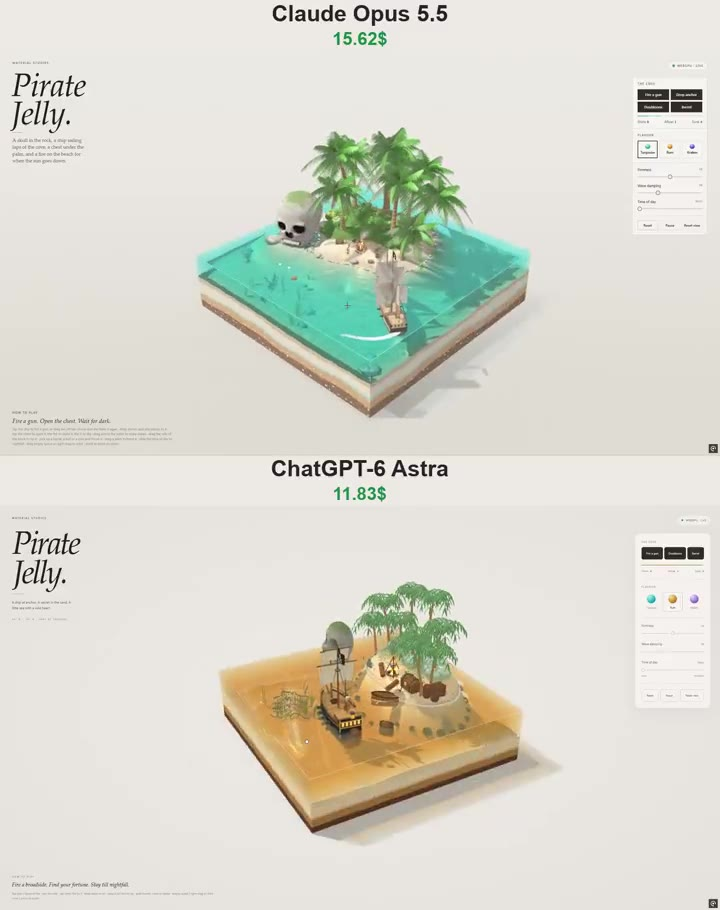

# 海盗果冻 Pirate Jelly

- **类型**：交互网页 / 果冻微缩场景
- **技术栈**：WebGPU · WGSL · 浅水模拟 · 刚体 · 粒子系统
- **标签**：`webgpu` `wgsl` `浅水模拟` `果冻` `sdf` `海盗` `昼夜循环` `material-studies` `vibe-coding` `ai-测试`
- **测试模型**：Claude Opus 5.5 vs ChatGPT-6 Astra
- **来源**：[@vib3coded](https://x.com/vib3coded) · [原帖](https://x.com/vib3coded/status/2108336208891801999) · [提示词帖](https://x.com/vib3coded/status/2108336611796615233) · 2026-10-09（北京时间）

> 说明：这是 [@vib3coded](https://x.com/vib3coded) 用来横向测试 AI 模型的提示词（同一提示词交给 Claude Opus 5.5 vs ChatGPT-6 Astra）。提示词里提到的「Material Studies 果冻微缩场景系列」是作者此前同系列的作品，源码未公开；没有原作时可让 AI 按文中描述从头搭建。界面上的按钮、标题、提示语等文字按原提示词要求保持英文（引号里的英文原样保留）。优先使用英文原文；中文翻译附在后面。

---

## 效果



## 提示词（英文原文）

```text
Create a self-contained interactive WebGPU/WGSL page "Pirate Jelly" — part of a "Material Studies" series of jelly dioramas. Single HTML file, no external models, textures, fonts or libraries; everything procedural. English UI.

LOOK & LAYOUT
- A square block of translucent jelly sea (≈5.2 × 5.2 units) standing on a paper-studio floor; the camera looks in at the front corner at ~27°. The block's cut faces show candy strata (chocolate bedrock, caramel clay, a shell band, vanilla sand); the sea surface and walls refract and tint what's behind them, with caustics on the sea floor, light shafts, a tinted caustic shadow on the floor, foam lace on the shoreline and a bright meniscus on the cut edges.
- A small tropical island toward the back: sandy beach, a cove facing the viewer, a mossy jungle hump with ~9 gummy palms (ringed caramel trunks, translucent fronds that flutter), lumpy gummy bushes with flowers, ferns, beach grass, rocks around the shore.
- SKULL ROCK at the island's west tip, standing in the shallows: a cartoon skull sculpted as a signed-distance field (cranium, cheekbones, jaws, deep eye sockets, heart-shaped nose, crack on the crown, rock strata and noise, moss on top, a wet band at the waterline), meshed with surface nets; two rows of separate box teeth set into a carved grin. At night its eye sockets glow like a candle-lit cave.
- A PIRATE SHIP riding at anchor in front of the island, seen at three-quarters from the stern: black hull with an ochre gunport strake, red bottom, gunports with cannons, raised quarterdeck with lit stern windows and a stern lantern, three masts (square courses and topsails on fore and main, a gaff sail on the mizzen, a jib to the bowsprit), shrouds and stays, and a Jolly Roger (skull and crossed bones drawn procedurally in the shader) streaming aft. Her anchor chain runs from the bow down through the jelly to an anchor lying on the sea floor.
- The camp on the cove beach: a campfire (stone ring, teepee of logs with glowing ends, embers, a tripod with a pot, two seating logs), an iron-bound treasure chest under a leaning palm with a hinged lid and a heap of gold and gems inside, a shovel in a sand heap, barrels, a crate, a pyramid of round shot, a rum bottle, a rowing boat pulled up with its bow on the sand, and an "X" scored in the sand.
- On the sea floor: the bow half of an old wreck lying on its side with ribs showing and its broken mast beside it, swaying kelp, a few doubloons, bubbles caught in the jelly.

SIMULATION
- Linear shallow-water waves on a staggered grid with a little surface tension (springy jelly); the block can be tipped and the sea sloshes and the jelly wobbles (shear + squash).
- The ship floats on 10 buoyancy points (heave, pitch, roll), is pushed by a gently veering offshore breeze, held by an elastic anchor rode at the bow, and weathervanes into the wind. Her displaced volume is handed back to the sea, so she makes a wake.
- Rigid bodies: cannonballs (dense, fly in a clean arc, punch a crater, sink and roll on the floor), barrels (float on their side), doubloons (flutter down and settle flat). All interact with the sea (buoyancy, drag, splashes, bubbles), the terrain, the skull, the props, the palm trunks and the ship's hull.
- One particle system: fire flames (additive), embers, woodsmoke, muzzle flash, white gunsmoke, sea spray, sand puffs, gold glints over the open chest, fireflies at night.

INTERACTION
- Tap the ship → fire the next gun on the side facing the viewer (ball, flash, smoke, recoil heel). Drag the ship → tow her against the rode; release → she drifts back to her anchor.
- Tap the chest → lid swings open/shut with a bounce; gold glitters. Tap the fire → it roars and throws sparks. Tap the X → three doubloons pop out of the sand.
- Drag across the water to make waves; drag a side of the block to tip it; pick up and throw balls/barrels/coins; drag a palm to bend it; drag empty space or right-drag to orbit; wheel/pinch to zoom.

TIME OF DAY
- A slider from Noon → Afternoon → Golden hour → Sunset → Dusk → Night → Midnight. The sun lowers and warms, the backdrop turns peach, then the moon takes over (dim blue), stars appear on the backdrop, the page UI switches to a dark theme, and the campfire becomes the main light: a flickering point light that warms the sand, palms, sails and gold, reflects in the water, and lights the smoke from below. Stern windows and lantern glow.

UI (editorial, like the series)
- Top-left masthead: eyebrow "MATERIAL STUDIES", big italic serif title "Pirate / Jelly.", a short line of copy.
- Status pill (WebGPU · Live / Paused / Unavailable).
- Right glass panel: "The cove" — buttons Fire a gun / Doubloons / Barrel, a liveliness meter, tally Shots · Afloat · Sunk; "Flavour" — Turquoise, Rum (amber), Kraken (violet) jelly palettes; sliders Firmness, Wave damping, Time of day; Reset / Pause / Reset view.
- Bottom-left "How to play" line plus small instructions. Space fires a gun.
- Mobile: the panel becomes a bottom sheet; touch orbit and pinch zoom.
- Fallback card when WebGPU (or an adapter) isn't available. Respect prefers-reduced-motion.
```

---

## 提示词（中文）

创建一个自包含的交互式 WebGPU/WGSL 页面 "Pirate Jelly"——属于 "Material Studies" 果冻微缩场景系列。单个 HTML 文件，不用外部模型、纹理、字体或库；一切都是程序化生成。界面为英文。

### 外观与布局

- 一块半透明果冻海（约 5.2 × 5.2 单位）立在纸质摄影棚地面上；相机以约 27° 从前方转角向内看。块的切面露出糖果地层（巧克力基岩、焦糖黏土、贝壳带、香草沙）；海面和侧壁会折射并染色其后方的物体，海底有焦散，有光柱，地面上有带色调的焦散阴影，岸线有泡沫蕾丝，切边有明亮的弯月面。
- 靠后方一座小热带岛：沙滩、一个面向观众的小海湾、一个长满苔藓的丛林小丘，上面有约 9 棵软糖棕榈树（环纹焦糖树干、会飘动的半透明叶子）、开花的团块状软糖灌木、蕨类、海滩草、岸边的岩石。
- 岛的西端浅水中立着骷髅岩（SKULL ROCK）：用有向距离场雕刻的卡通骷髅（颅顶、颧骨、颌骨、深眼窝、心形鼻孔、头顶裂缝、岩层与噪声、顶部苔藓、水线处一条湿痕带），用 surface nets 生成网格；两排独立的方块牙齿嵌在雕出的咧嘴笑中。夜晚它的眼窝会像点着蜡烛的洞穴一样发光。
- 一艘海盗船在岛前抛锚停泊，从船尾四分之三角度看：黑色船体配赭色炮门列板，红色船底，炮门里有大炮，抬高的后甲板带亮灯的船尾窗和船尾灯笼，三根桅杆（前桅和主桅上有横帆主帆和上桅帆，后桅是斜桁帆，一面三角帆连到船首斜桅），侧支索和支索，以及一面骷髅旗（Jolly Roger，骷髅和交叉骨在着色器中程序化绘制）向后飘扬。锚链从船首穿过果冻向下，连到躺在海底的锚上。
- 海湾沙滩上的营地：篝火（石圈、末端发光的圆锥形木柴堆、余烬、挂着锅的三脚架、两根当座位的原木），一棵倾斜棕榈树下的铁箍宝箱，带铰链箱盖，里面堆着金币和宝石，一把插在沙堆里的铲子，木桶，一个板条箱，一堆金字塔形的圆炮弹，一瓶朗姆酒，一艘船头搁在沙滩上的划艇，以及沙地上划出的一个 "X"。
- 海底：一艘旧沉船的船首半截侧躺着，露出肋骨，旁边是折断的桅杆，摇曳的海带，几枚金币（doubloons），被困在果冻里的气泡。

### 模拟

- 交错网格上的线性浅水波，带一点表面张力（富有弹性的果冻）；块可以被倾斜，海水晃荡，果冻晃动（剪切 + 压扁）。
- 船漂浮在 10 个浮力点上（起伏、俯仰、横滚），被一阵缓慢转向的离岸风推动，由船首一根有弹性的锚缆拉住，并像风向标一样迎风转向。它排开的体积还给海，所以会产生尾迹。
- 刚体：炮弹（密度大，划出干净的弧线，砸出水坑，下沉并在海底滚动）、木桶（侧躺漂浮）、金币（飘落后平躺）。它们都与海（浮力、阻力、水花、气泡）、地形、骷髅、道具、棕榈树干和船体相互作用。
- 一个粒子系统：火焰（加法混合）、余烬、柴烟、炮口火光、白色硝烟、海浪飞沫、沙尘、打开的宝箱上方闪烁的金光、夜晚的萤火虫。

### 交互

- 点击船 → 朝向观众一侧的下一门炮开火（炮弹、火光、烟雾、后坐倾斜）。拖动船 → 拉着它与锚缆对抗；松手 → 它漂回锚位。
- 点击宝箱 → 箱盖带弹跳地开/关；金子闪烁。点击篝火 → 火势变旺并迸出火星。点击 X → 三枚金币从沙里蹦出来。
- 在水面拖动造浪；拖动块的侧面使其倾斜；捡起并扔出炮弹/木桶/金币；拖动棕榈树使其弯曲；拖动空白处或右键拖动来环绕视角；滚轮/双指缩放。

### 时间

- 一个从 Noon → Afternoon → Golden hour → Sunset → Dusk → Night → Midnight 的滑块。太阳降低并变暖，背景变成桃色，然后月亮接管（昏暗的蓝色），背景上出现星星，页面 UI 切换为深色主题，篝火成为主光源：一个闪烁的点光源，照暖沙子、棕榈、船帆和金子，在水中反射，并从下方照亮烟雾。船尾窗和灯笼发光。

### UI（编辑风格，与系列一致）

- 左上刊头：眉标 "MATERIAL STUDIES"，大号斜体衬线标题 "Pirate / Jelly."，一行短文案。
- 状态胶囊（WebGPU · Live / Paused / Unavailable）。
- 右侧玻璃面板："The cove"——按钮 Fire a gun / Doubloons / Barrel，一个活跃度仪表，计数 Shots · Afloat · Sunk；"Flavour"——Turquoise、Rum（琥珀色）、Kraken（紫罗兰色）果冻配色；滑块 Firmness、Wave damping、Time of day；Reset / Pause / Reset view。
- 左下 "How to play" 一行加小字说明。空格键开炮。
- 移动端：面板变为底部抽屉；触摸环绕和双指缩放。
- WebGPU（或 adapter）不可用时显示降级卡片。遵守 prefers-reduced-motion。
