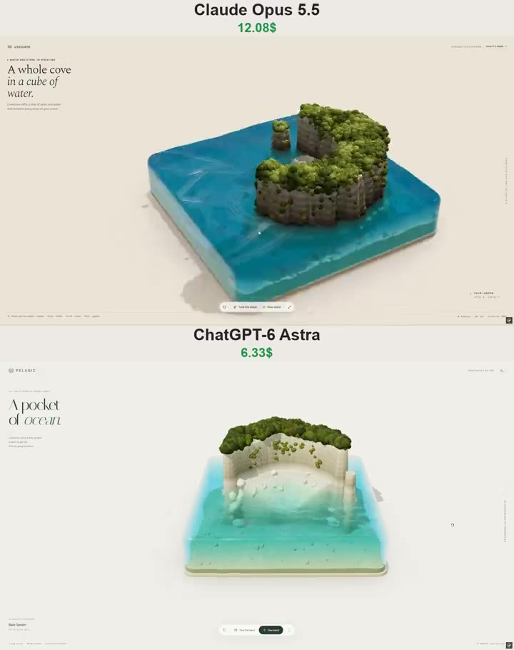

# 水块里的热带海湾 Tropical Cove

- **类型**：交互网页 / 3D 水体微缩场景
- **技术栈**：Three.js r160 · WebGL · GPU 波动方程 · 单文件 HTML
- **标签**：`threejs` `webgl` `水面模拟` `beer-lambert` `移轴` `程序化地形` `微缩场景` `vibe-coding` `ai-测试`
- **测试模型**：Claude Opus 5.5 vs ChatGPT-6 Astra
- **来源**：[@vib3coded](https://x.com/vib3coded) · [原帖](https://x.com/vib3coded/status/2109345073703862419) · [提示词帖](https://x.com/vib3coded/status/2109345365761696119) · 2026-10-12（北京时间）

> 说明：这是 [@vib3coded](https://x.com/vib3coded) 用来横向测试 AI 模型的提示词（同一提示词交给 Claude Opus 5.5 vs ChatGPT-6 Astra）。原提示词没有给作品起名，文件名按内容命名。界面上的按钮、标题、提示语等文字按原提示词要求保持英文（引号里的英文原样保留）。英文原文附在文末。

---

## 效果



## 提示词（中文）

构建一个单文件交互式 WebGL 微缩场景（一个 index.html，无构建步骤），通过 import map 从 cdn.jsdelivr.net 加载 Three.js r160，并从 three/examples/jsm 引入 OrbitControls 和 BufferGeometryUtils。

### 场景

一个 10×10 的透明水块中的微缩热带海湾，水块边缘为圆角（竖直转角半径约 0.6，顶边半径约 0.26），放在一块薄薄的沙色底板上，背景为暖白色，地面有柔和阴影（ShadowMaterial + 模糊的接触阴影）。

### 岛屿（程序化、带种子、可重新生成）

- 高度场地形（约 400×400 网格），裁切到圆角水块内，沿边界有一圈"裙边"墙，使横截面透过水体可见。
- 形状：由 IQ 风格的二维圆弧 SDF 构成的新月形石灰岩悬崖（每侧开口约 75–100°，粗壮的两臂向尖端逐渐变细），用 fbm 做域扭曲（domain warp），让轮廓显得自然。开口朝向相机。
- 近乎竖直的悬崖（约 2 单位高），边缘略圆；外侧悬崖直插深水（没有浅滩台阶）；海湾内侧是一片浅色沙滩，缓缓倾斜入松石绿浅水。
- 可选：在一侧臂尖附近放一根海蚀柱。臂尖和沿海滩分布的巨石（置换过的 icosphere，实例化）。海床上散落着小块深色岩石。
- 在片元着色器中按世界高度给岩石着色：水平的沉积岩层（扭曲的正弦条带）、较暗的竖直滴痕、顶部奶油色石灰岩、水线附近较深的棕色、水面正上方一条更暗的"湿"带、水面下被藻类染暗的岩石。通过 dFdx/dFdy 做程序化凹凸。在 CPU 上按顶点烘焙地平线环境光遮蔽（horizon AO）。
- 植被：约 5k 个"花椰菜"状树冠团块（icosphere 的 InstancedMesh，带顶点噪声置换和片元凹凸），每棵树 2–5 个成簇，橄榄绿到黄绿色调色板，按实例根据邻近遮挡计算 AO，顶部更亮。高台上有裸露的奶油色岩石斑块；少量植被团簇攀附在崖壁上。

### 水（关键部分——要写实，不是果冻）

- 渲染管线：(1) 不透明场景 → 带 DepthTexture 的 MSAA HalfFloat 渲染目标；(2) 复制到第二个目标，然后用自定义 ShaderMaterial 绘制水面网格，对场景深度做手动深度测试；(3) 最后一个全屏通道，做 ACES 色调映射、sRGB 输出和轻微的移轴模糊（tilt-shift，微缩效果）。Canvas 透明，以透出 CSS 背景。
- 水色来自真实厚度：重建每个水像素后方物体的视空间深度，计算路径长度 L，按 Beer–Lambert 吸收 exp(-absorb·L) 趋向由用户所选水色派生出的深蓝散射色。浅海湾 = 松石绿，深处 = 蓝色，侧壁获得额外路径长度，因此呈现为半透明水体。
- 按表面法线偏移的屏幕空间折射（丢弃落在水面前方的采样），菲涅尔天空反射，由精细动态细节法线产生的锐利阳光闪烁。
- 涟漪：在 256×256 HalfFloat ping-pong 目标上做 GPU 波动方程模拟（Evan Wallace 风格），固定 60 Hz 步长，用陆地遮罩纹理让波浪在岸边和墙壁反射。鼠标在水面上移动时沿光标路径注入胶囊形水滴（强度取决于速度）；点击/轻触产生水花。涟漪坡度添加淡淡的天空色高光和微弱的泡沫痕迹。
- 岸边泡沫**只**出现在平缓斜坡上：从陆地纹理计算地形坡度，在陡峭处抑制泡沫，否则悬崖与水面交界处会出现一圈白色轮廓。泡沫应被噪声打碎，并轻柔地"呼吸"。
- 海床上的程序化动态焦散（自发光，随深度衰减）。
- 潮位控制升降整个水块（边缘移动，侧面拉伸）。开场动画：水注满水块，同时相机缓缓推近。

### UI（编辑风格、极简）

左上角文字标识，大号衬线标题，小号大写元信息标签，右侧竖排说明文字，一个带生成名称和坐标的地点标签，一个悬浮胶囊工具栏（reset、"Tune the island"、"New island"、全屏），页脚放提示和自适应 FPS 读数。一个玻璃质感的设置面板，包含水色、波高、涟漪强度、阻尼、潮位、清澈度、焦散、太阳方位角、太阳高度角、移轴。通过 CSS token 实现亮色和暗色主题，响应式适配到 390 px（面板变为底部抽屉），遵守 prefers-reduced-motion，自适应像素比，并为触屏设备提供更轻量的模式。

---

<details>
<summary>英文原文（English original）</summary>

```text
Build a single-file interactive WebGL diorama (one index.html, no build step) with Three.js r160 loaded via an import map from cdn.jsdelivr.net, plus OrbitControls and BufferGeometryUtils from three/examples/jsm.

SCENE
A miniature tropical cove inside a 10×10 block of clear water with rounded edges (vertical corner radius ~0.6, top edge radius ~0.26), sitting on a thin sand-colored base slab, on a warm off-white background with a soft floor shadow (ShadowMaterial + blurred contact shadow).

ISLAND (procedural, seeded, regenerable)
- Heightfield terrain (~400×400 grid) clipped to the rounded block, with a "skirt" wall along the boundary so the cross-section is visible through the water.
- Shape: a crescent of limestone cliffs built from an IQ-style 2D arc SDF (aperture ~75–100° each side, thick arms tapering toward the tips), domain-warped with fbm so the outline is organic. Opening faces the camera.
- Near-vertical cliffs (~2 units tall) with slightly rounded rims; outside, the cliffs plunge straight into deep water (no shallow ledge); inside the cove a pale sand beach slopes gently into turquoise shallows.
- Optional sea stack near one arm tip. Boulders at the arm tips and along the beach (displaced icospheres, instanced). Small dark rocks scattered on the seabed.
- Rock shading in the fragment shader by world height: horizontal sedimentary strata (warped sine bands), darker vertical drip stains, cream limestone on top, darker brown near the waterline, a darker "wet" band just above the water, algae-darkened rock below the surface. Procedural bump via dFdx/dFdy. CPU-baked horizon ambient occlusion per vertex.
- Vegetation: ~5k "cauliflower" canopy blobs (InstancedMesh of icospheres with vertex-noise displacement and fragment bump), clustered 2–5 per tree, olive-to-yellow-green palette, per-instance AO from neighbour occlusion, brighter tops. Bare cream rock patches on the plateau; a few vegetation clumps clinging to cliff faces.

WATER (the key part — realistic, not jelly)
- Render pipeline: (1) opaque scene → MSAA HalfFloat render target with a DepthTexture; (2) copy that to a second target, then draw the water mesh with a custom ShaderMaterial that does a manual depth test against the scene depth; (3) a final fullscreen pass with ACES tone mapping, sRGB output and a subtle tilt-shift blur (miniature look). Canvas is transparent so the CSS background shows through.
- Water color from real thickness: reconstruct the view-space depth of what's behind each water pixel, compute the path length L, apply Beer–Lambert absorption exp(-absorb·L) toward a deep-blue scatter color derived from a user-picked water color. Shallow cove = turquoise, deep = blue, side walls get extra path length so they read as a translucent water volume.
- Screen-space refraction offset by the surface normal (reject samples that land in front of the surface), Fresnel sky reflection, sharp sun glints from fine animated detail normals.
- Ripples: GPU wave-equation simulation on a 256×256 HalfFloat ping-pong target (Evan Wallace style), fixed 60 Hz steps, a land mask texture so waves reflect off the shore and walls. Moving the mouse over the water injects capsule-shaped drops along the cursor path (strength by speed); a click/tap makes a splash. Ripple slope adds a light sky-colored highlight and faint foam trails.
- Shore foam ONLY on gentle slopes: compute terrain slope from the land texture and suppress foam where slope is steep, otherwise a white outline appears where cliffs meet the water. Foam should be broken by noise and gently "breathe".
- Procedural animated caustics on the seabed (emissive, fading with depth).
- Tide control raises/lowers the whole water block (rim moves, sides stretch). Intro animation: water fills the block while the camera eases in.

UI (editorial, minimal)
Wordmark top-left, a large serif headline, small uppercase meta labels, a vertical caption on the right, a location label with generated name and coordinates, a floating pill dock (reset, "Tune the island", "New island", fullscreen), hints and an adaptive FPS readout in the footer. A glassy settings panel with water color, wave height, ripple strength, damping, tide level, clarity, caustics, sun azimuth, sun elevation, tilt-shift. Light and dark themes via CSS tokens, responsive down to 390 px (panel becomes a bottom sheet), prefers-reduced-motion respected, adaptive pixel ratio and a lighter mode for touch devices.
```

</details>
